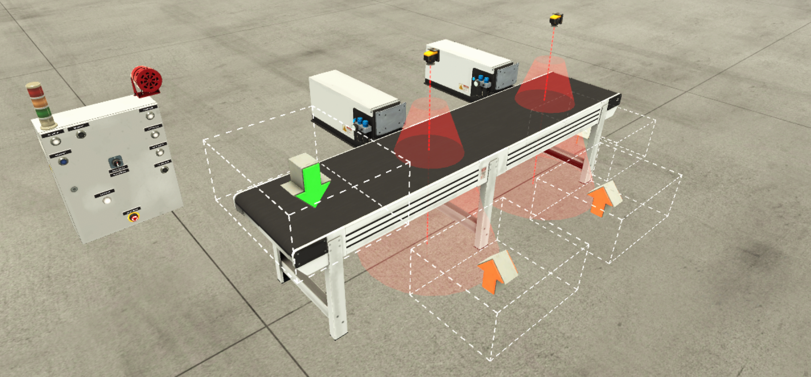
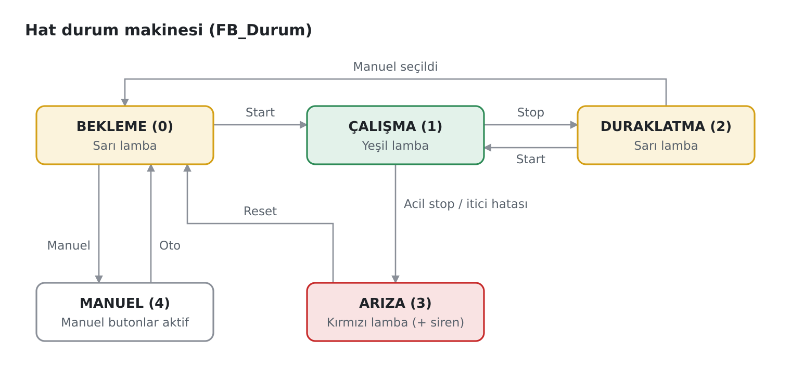

# PLC ile Renk Bazlı Ürün Ayırma Konveyör Hattı

Siemens S7-1200 PLC ile kontrol edilen ve ürünleri renklerine göre ayıran bir konveyör hattı. Hat, Factory I/O ile kurulan 3D sanal fabrikada uçtan uca devreye alınmıştır. Vision sensörler mavi ve yeşil parçaları tanır; her parça kendi iticisiyle banttan alınır. Metal (tanımsız) parçalar hattın sonuna kadar gider.

> **English summary:** A color sorting conveyor line controlled by a Siemens S7-1200 PLC (TIA Portal V21, S7-PLCSIM) and commissioned end-to-end in a Factory I/O 3D virtual plant. The project includes a state machine (Idle / Running / Paused / Fault / Manual), Auto/Manual modes, emergency stop with safe restart, a pusher position fault alarm, reusable function blocks (Ladder + SCL) and full documentation (I/O list, functional description, state diagram, FAT test list).



## Demo

<!-- Demo videosunu bu satirin yerine surukleyip birakin -->

*Start → renk ayırma → Stop → acil stop → Reset → yeniden Start*

## Kullanılan araçlar

| Araç | Kullanım |
|---|---|
| Siemens TIA Portal V21 | PLC programlama (LAD + SCL), tag yönetimi |
| S7-PLCSIM V21 | Sanal PLC: S7-1200, CPU 1211C DC/DC/DC |
| Factory I/O 2.5 | 3D sanal fabrika: bant, vision sensörler, iticiler, operatör paneli |

## Hat yerleşimi

```
                [Çıkış 1]          [Çıkış 2]
Emitter → ═══════[Vision 1]═════════[Vision 2]══════════ → Remover
                [İtici 1]          [İtici 2]
                 (mavi)             (yeşil)
```

1. Vision sensör kendi rengini algılayınca bant durur.
2. İtici ileri gider; ileri limit sensörüne ulaşınca geri döner.
3. İtici geri limit sensörüne ulaşınca bant yeniden çalışır.

## Özellikler

- **Durum makinesi:** Bekleme → Çalışma → Duraklatma → Arıza → Reset, ayrıca Manuel durum
- **Otomatik ve manuel modlar:** Mod geçişi yalnızca Bekleme'de yapılır; çalışırken Manuel'e geçilirse hat önce kontrollü olarak durur
- **Acil stop ve güvenli yeniden başlatma:** Acil stop çözülse bile hat kendiliğinden kalkmaz; önce Reset, sonra Start gerekir
- **Alarm:** İtici, 3 sn içinde limit sensörüne ulaşamazsa pozisyon hatası verilir (kırmızı lamba + siren)
- **Kilitlemeler:** İticilerden biri öndeyken bant çalışmaz; manuel butonlar sadece Manuel durumda geçerlidir
- **Fail-safe tasarım:** Stop ve acil stop NC kontaklıdır; kablo kopması hattı durdurur
- **Modüler yazılım:** Tekrar kullanılabilir fonksiyon blokları; aynı FB iki itici için iki kez çağrılır

## Durum makinesi



| Durum | Bant / Emitter | Lamba |
|---|---|---|
| 0 BEKLEME | Durur | Sarı |
| 1 ÇALIŞMA | Çalışır | Yeşil |
| 2 DURAKLATMA | Durur (başlamış itme tamamlanır) | Sarı |
| 3 ARIZA | Durur, iticiler geri çekilir | Kırmızı (+ siren) |
| 4 MANUEL | Sadece jog | Sarı |

## Yazılım mimarisi

Basit kilitlemeler Ladder (LAD), mantık ağırlıklı kısımlar SCL ile yazılmıştır.

| Blok | Dil | Görevi |
|---|---|---|
| `OB1` (Main) | LAD | Blokları sırayla çağırır; bant izni, jog izni, Emitter |
| `FB_Durum` | SCL | Durum makinesi, mod geçişleri, acil stop / reset, lambalar ve siren |
| `FB_Itici` | SCL | İtici adım zinciri (Boş → İleri → Geri / Hata), zaman aşımı alarmı, manuel itme. İki instance: `IDB_Itici1`, `IDB_Itici2` |
| `FB_Bant` | LAD | Bant motoru: (otomatik istek VEYA manuel jog) VE izin |

**OB1 çağrı sırası:** Haberleşme → FB_Durum → İtici 1 → İtici 2 → bant izni → jog izni → FB_Bant → Emitter. İticiler bant bloğundan önce hesaplanır; böylece bant, iticilerin "meşgul" bilgisini aynı taramada kullanır.

**İsimlendirme standardı:** `I_` giriş, `Q_` çıkış, `FB_` fonksiyon bloğu, `IDB_` instance veri bloğu.


## I/O özeti

14 dijital giriş, 8 dijital çıkış. Tam liste için: [IO_Listesi.xlsx](IO_Listesi.xlsx)

| Grup | Adresler | Sinyaller |
|---|---|---|
| Operatör girişleri | %I0.0 – %I0.7 | Start, Stop (NC), Reset, Acil Stop (NC), Oto/Manuel, 3 manuel buton |
| Saha girişleri | %I1.0 – %I1.5 | 2 vision sensör, 4 itici limit sensörü |
| Çıkışlar | %Q0.0 – %Q0.7 | Bant, 2 itici, Emitter, yeşil/sarı/kırmızı lamba, siren |

## Test

Devreye alma, sahadaki sırayla yapılmıştır: önce haberleşme ve I/O testi (loop check), sonra kod. Sistem **22 testlik FAT listesiyle** doğrulanmış ve testlerin tamamı geçmiştir: I/O, otomatik çalışma, acil stop, manuel mod ve alarm. Ayrıntılar için: [FAT_Test_Listesi.xlsx](FAT_Test_Listesi.xlsx)

## Dokümanlar

| Doküman | Dosya |
|---|---|
| Fonksiyonel tanım | [Fonksiyonel_Tanim.pdf](Fonksiyonel_Tanim.pdf) |
| I/O listesi | [IO_Listesi.xlsx](IO_Listesi.xlsx) |
| FAT test listesi | [FAT_Test_Listesi.xlsx](FAT_Test_Listesi.xlsx) |
| Proje raporu | [Proje_Raporu.pdf](Proje_Raporu.pdf) |
| Durum diyagramı | [Durum_Diyagrami.png](Durum_Diyagrami.png) |

## Nasıl çalıştırılır?

**Gereksinimler:** TIA Portal V21, S7-PLCSIM V21, Factory I/O (S7-PLCSIM sürücüsünü içeren bir sürüm)

1. `Konveyor_Renk_Ayirma.zap21` dosyasını TIA Portal'da **Project → Retrieve** ile aç.
2. `PLC_1`'i seç, **Start simulation** ile PLCSIM'i başlat ve programı yükle. CPU'yu RUN moduna al.
3. `.factoryio` uzantılı sahne dosyasını Factory I/O'da aç.
4. Factory I/O'da **File → Drivers → Siemens S7-PLCSIM** seç, **Connect**'e bas ve ardından **Play**'e bas.
5. Seçici anahtarı **0 (Oto)** konumuna getir ve **Start**'a bas.

> Not: Proje, Factory I/O'nun S7-1200 için hazırladığı TIA Portal şablonundan oluşturulmuştur. OB1'in 1. network'ündeki haberleşme bloğu, Factory I/O ile PLCSIM arasındaki bağlantı için gereklidir.

## Güvenlik notu

Bu simülasyonda acil stop PLC yazılımıyla değerlendirilmektedir. **Gerçek bir sistemde acil stop yazılımla değil, donanımsal güvenlik devresiyle (güvenlik rölesi veya F-CPU) sağlanır.** Güvenlik fonksiyonlarının kapsamı risk değerlendirmesiyle belirlenir (EN ISO 12100, EN ISO 13849-1).

## Repo içeriği

| Dosya | İçerik |
|---|---|
| `Konveyor_Renk_Ayirma.zap21` | TIA Portal V21 proje arşivi |
| `FB_Durum.scl`, `FB_Itici.scl` | SCL kaynak dosyaları |
| `IO_Tablosu_Import.xlsx` | TIA Portal tag import dosyası |
| `*.factoryio` | Factory I/O sahnesi |
| `Fonksiyonel_Tanim.pdf` / `.docx` | Fonksiyonel tanım |
| `IO_Listesi.xlsx` | I/O listesi |
| `FAT_Test_Listesi.xlsx` | FAT test listesi |
| `Proje_Raporu.pdf` | Proje raporu |
| `Durum_Diyagrami.png`, `Factory.1.png` | Görseller |

## Sonraki adım

Bu hatta WinCC ile bir HMI/SCADA ekranı eklenmesi planlanmaktadır: durum göstergeleri, alarm listesi ve manuel kontrol.
